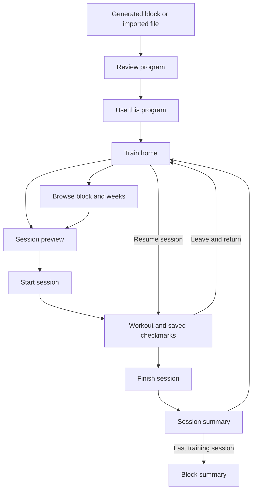
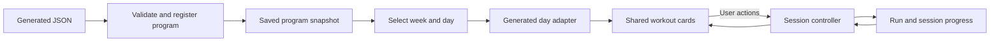

# Generated program experience: design brief

Design a mobile experience that takes someone from a generated six-week block to their next session, lets them follow the prescription during training, and reliably remembers their place.

**Product direction**

Generate and save the entire block once. Let the user train when they are ready, following its session order. The everyday entry point is “Next session,” with the complete six-week plan always available to browse.

“On demand” describes when someone opens and performs a session. Starting a session reads the saved plan; it does not generate another workout. The progression and alternating exercises belong to the six-week block and must remain consistent throughout a run.

Use these defaults for the first version:

- One program is promoted on the home screen. Other saved programs remain available in the library.
- Six program weeks describe the progression. They can take longer than six calendar weeks to finish.
- Dates are suggested dates. A missed date never completes, skips, or changes a session.
- Recovery sessions remain visible and recommended in the plan, but are optional for progress tracking. Rest/note days require no completion action.
- Any session can be previewed. Opening a preview never starts a session or changes progress.
- Starting and finishing are explicit actions. Completing all checkmarks does not automatically finish a session.

**What the current code already provides**

The generator returns `{ options, weeks, checks, plan, warnings }`. Each week contains seven days; each day contains ordered sections, exercises, and set prescriptions. Some older saved files omit `checks`.

The example [Pump Lift 3x block](../data/generated/pump-lift-3x-seed28-2026-11-02.json) contains 18 training sessions, 18 recovery days, and six rest/note days. Its first training session is “Sumo Deadlift + Push Press.” Count training sessions when displaying program progress; the 42 day entries are not 42 required workouts.

The [generated adapter](../src/domain/generated.ts) and [generated components](../src/components/GeneratedWorkout.tsx) can already turn this data into the shared workout cards. The existing app also has library, program, week, and session routes, plus persistent program runs and session completion.

The integration work still needed is important: generated files have no importer in the current repository, those generated components are not wired into the app routes, and set/round checkmarks currently live only in React state. The current whole-program component renders all weeks and days consecutively; it is a rendering building block, not the proposed navigation experience.

**The journey to design**



For the first implementation, importing an existing generated JSON file is a sufficient entry point. A generation form can be added later and feed the same review screen. The user should not need to know a filename, seed, or JSON structure to follow a saved program.

**Screen requirements**

| Surface | What it needs to communicate | Primary action |
| --- | --- | --- |
| Program review | Program name, six weeks, training frequency, training-session count, suggested start date, equipment, first-week preview, relevant generation caveats | Use this program |
| Train home | Active program, current program week, completed training sessions, next session, or the session already in progress | Start session / Resume session |
| Program and week browser | Six-week navigation, ordered session cards, completion states, optional recovery, rest days, progression detail | Open a session |
| Session | Exact prescription, section order, exercise instructions, set/round completion, timers, saved state | Start session, then Finish session |
| Session summary | Saved completion, any unfinished checkmarks, optional personal note, what comes next | Back to program |
| Block summary | Training sessions completed, completion dates, access to past sessions, next program choices | Choose next program |

Review and active-program overview should share a layout. Session preview and the active workout should share a layout too, with different actions and progress visibility. Session and block summaries can be completion states instead of separate top-level destinations.

**1. Review and activate the block**

Use a readable title such as “Pump Lift · 3 days/week.” Show “6 weeks · 18 training sessions.” The review should help someone answer: Can I follow this schedule, do I have the equipment, and what will I be doing?

Show Week 1 as a compact list with the main lifts. Let the user switch to any other week and open a session preview. A secondary progression view can show the main lift for each session across weeks 1–6; take the actual weekly prescriptions from `weeks`, with `plan` providing the A/B exercise summary where available.

Translate generation caveats into their practical effect. An equipment mismatch needs to identify the affected exercise and let the user revise the generation inputs or choose another block. Reusing a recent exercise is an informational caveat. Invalid or incomplete workout structure prevents activation. Missing historical check results mean “Checks unavailable”; they do not imply that checks passed. Seed, donor blocks, and diagnostic details can live in an expandable program-details area.

“Use this program” saves the block and creates or selects a run. It does not mark the first session as started. If another run is already promoted, preserve it and its history when switching the home-screen program.

**2. Make Train home the daily entry point**

The first screen after returning should answer “What is next?” without requiring Library → Program → Week → Session navigation.

Suggested hierarchy:

```text
Pump Lift · 3 days/week                  View program
Week 2 of 6 · 4 of 18 training sessions complete

Next session
Week 2 · Session 2
[Main lift + second strength lift]
[Start session]

This program week
[Session 1: complete] [Session 2: next] [Session 3]

Optional recovery                       View recovery
```

When a session is in progress, replace “Next session” with “Resume session” and show its last saved section. Do not present a competing primary action to start another training session.

Current program week comes from the first unfinished training session, not today's calendar week. The next-session pointer follows training-session order and ignores optional recovery and rest/note entries. Viewing a later week does not move this pointer. A deliberate start of a later session records progress there; unfinished earlier sessions remain available and remain next in the ordinary sequence.

After the week's training is finished, present the next program week as available. Avoid missed-day penalties, automatic catch-up workouts, or silently rearranged dates. This interaction changes neither the prescribed recovery spacing nor the workout content; the week browser retains the original suggested schedule.

**3. Make the block easy to browse**

Use a six-week selector above an ordered list of days. On mobile, use session cards with quieter recovery/rest rows. Desktop can add an overview grid, while preserving the same selection and status model.

Training cards need a session number within the week, main-lift title, suggested weekday, and status: Not started, In progress, or Complete. Recovery cards say “Optional recovery.” Empty note days display “Rest day” inline rather than linking to an empty workout page. If a note day contains text, offer it as a readable note.

Generated `day` is a calendar position, not the ordinal of a training session. In the 3x example, days 1, 3, and 5 become training Sessions 1, 2, and 3. Keep the suggested weekday as secondary context. Use the word “Session” consistently in navigation.

Progress always uses training sessions as the denominator: 18 for a six-week 3x plan, 24 for 4x, and 30 for 5x. Derive the actual count from day types instead of assuming every file has that length. Track optional recovery separately.

**4. Design the session for use during training**

Keep the familiar workout cards. The work here is navigation, clear prescription, and durable progress around those cards.

At the top, show program, program week, session number, title, and a brief section list. A visible Start session action changes the preview into an active session. The active view has a persistent Finish session action and an indication that progress is saved.

Preserve section order: focus notes, warmup, strength work, balance, finisher or conditioning, and cooldown, with track-specific sections where present. Let the user collapse sections and jump to the section they need. Keep the whole session available; a mandatory exercise-by-exercise wizard is unnecessary for the first version.

Exercise content must preserve:

- Warmup versus working sets and individual set targets. A 12/10/8 progression must not collapse into “3 × 12.”
- Rep ranges, maximum reps, time, distance, calories, and per-side instructions.
- Target RPE, effort notes, tempo, prescribed load where provided, and rest ranges.
- Superset membership and rounds; conditioning format, time cap, intervals, and instructions.
- Exercise alternatives supplied in the content, without silently changing the plan.

Use large set/round checkmarks and optional timers with explicit start, pause, and reset controls. An exercise rest range such as 2–3 minutes should stay a range; a timer can offer a user-selected duration. Do not invent one prescribed duration. Preserve conditioning instructions as readable text when a dedicated format display is unavailable.

The generated adapter needs a completeness review before shipping this flow: its current output does not expose every field, including all raw instructions and prescribed loads. Do not mistake a rendered card for proof that the full prescription survived the mapping.

Only show a total duration estimate when it can be supported by the data, and label it as an estimate. Missing media should leave a useful text prescription. Supplied “short on time” guidance can be displayed, but should not automatically remove sections.

Leaving, navigating back, or reloading must retain set/round checkmarks and the active session. A timer can restore its deadline on return; background notifications are outside the first version.

**5. Finish and return**

Finish session explicitly saves completion. If some checkmarks remain empty, show a small “Finish with unchecked sets?” decision with actions to continue training or finish anyway. Someone can follow a session without checking every set.

The summary confirms completion and shows the next training session as a preview. Its primary action returns to the program; it does not automatically start the next workout. Allow completion to be undone, preserving checkmarks so an accidental finish is recoverable.

When all required training sessions are complete, show a block summary even if recovery sessions remain unmarked. Offer a new block or another run of the same saved block. A new run starts with empty progress and retains the previous run's history.

**How the JSON becomes this experience**



| Data | UI responsibility |
| --- | --- |
| `options.track`, `options.startDate` | Program identity and suggested schedule |
| `weeks`, `week.block.weekNumber`, `days[].type` | Week navigation, training-session order, recovery/rest treatment |
| `headline`, `focus` | Session titles, focus notes, short-on-time guidance |
| `sections`, `items`, `sets`, `scheme`, `raw` | Workout cards and complete prescription |
| `plan` entries whose `day` is not null | Optional summary of selected lifts and A/B variations; excluded source days stay hidden |
| `checks`, `warnings` | Review caveats and expandable program details |
| Separate run/progress records | Active session, completion, checkmarks, resume position, personal notes |

Import the full JSON once, validate it, and save an immutable snapshot locally. The route loads the selected day from that snapshot and passes it through `buildGeneratedDayView()` to the shared renderer. Navigation and resuming do not call the generator or require the analysis CSVs, source PDFs, or local D1 database.

Keep program content and personal progress separate. Add generated-program support to the repository and route loaders; do not pass this file unchanged to `importBundle()`, which currently expects a manifest plus source assignment arrays. Preserve the generated structure rather than translating it into the older assignment format just to reuse that importer.

Register stable program, week, and session IDs once and persist the mapping. Generated `block.id` is currently `0`, session IDs are negative values reused across generated files, and current card keys include dates. None is sufficient as a global progress identity. Use the app's canonical `sessionKey(programId, sessionId)`, scoped to a run for completion, and add stable section/item keys for saved checkmarks. Dates and display order must be editable without changing identity.

Add schema/generator version metadata and a snapshot fingerprint for future imports and duplicate detection. Store the actual generated payload, since a seed alone cannot reproduce a program after the generator or source corpus changes. Legacy files need validation and an explicit compatibility path.

Save all six weeks of text on import so the block can be followed offline. Media is a separate download with a separate availability status. Export/restore must include the generated snapshot and its progress together; the current progress-only export would not reconstruct a privately generated program on another device.

**First version and later work**

The first version needs generated-file import, review/activation, a next-session home card, week browsing, session preview/start/resume/finish, saved set and round checkmarks, separate run history, offline text, and a restorable backup. Reuse the current route hierarchy and workout renderer.

Actual weight/reps/RPE logging, exercise-history comparisons, calendar rescheduling, exercise substitutions, mid-block regeneration, adaptive programming, and performance charts can follow. The first version tracks adherence; it must not claim strength or fitness improvements from completion data alone. A future generation form can use the same import/registration path and review screen.

**Design deliverables and acceptance scenarios**

Produce mobile layouts for program review, Train home, a selected week, session preview, active session, finish decision, and completed block. Show desktop adaptations for the week browser and active session. Annotate primary actions, saved-state feedback, and how preview differs from active training.

Cover these scenarios in the designs:

1. A new user imports the 3x sample, sees 18 required sessions, previews Week 6, then activates the block without starting a workout.
2. The user starts Week 1 Session 1, checks two working sets, leaves the app, and returns to the same saved session.
3. A missed suggested date leaves the same next session waiting. Later program weeks remain browsable.
4. Optional recovery and empty rest days do not prevent Week 2 from becoming the next program week.
5. A session shows exact per-set reps/RPE, a superset, a rest range, and conditioning instructions without losing content.
6. The user finishes with unchecked sets, then undoes an accidental completion without losing those checkmarks.
7. An equipment caveat is understandable and actionable; an older file without check results does not show a false pass.
8. A saved block opens after an offline reload, with text available even when media is missing.
9. Completing all training sessions shows the block summary; repeating the block creates a separate run.
10. Restoring a backup restores both the generated program and the user's place in it.
